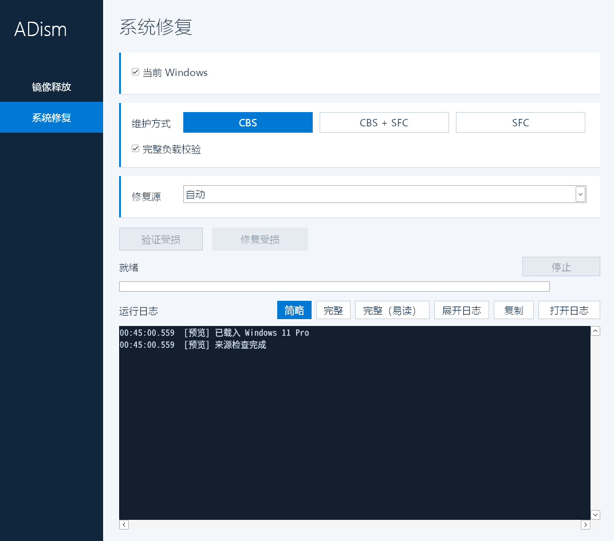

# ADism

ADism 是一个用于 Windows 系统修复和镜像部署的原生图形工具。它把系统组件检查、系统文件修复、修复来源选择和 Windows 镜像释放放在同一个界面中，并保留执行过程与原始错误，便于判断任务完成到了哪一步。

当前版本为 **0.7.0 Beta 1**，主要在 Windows 11 x64 环境验证。

[下载测试版](https://github.com/hzwzwzw/ADism/releases/tag/v0.7.0-beta.1) · [验证范围](docs/validation.md) · [问题反馈](https://github.com/hzwzwzw/ADism/issues)

## 功能

- **系统修复**：检查和修复组件存储，检查和修复受保护的系统文件。可选择组件服务、系统文件检查器，或依次执行两者。
- **修复来源**：支持自动选择、健康 Windows 目录、WIM 镜像及其映像版本，以及在线系统的 Windows Update 来源。
- **镜像部署**：读取 WIM 中的映像列表，选择版本后释放到空白分区，可设置便携式系统选项并写入引导文件。
- **分区识别**：按硬盘和分区选择目标，同时查看卷标、容量、文件系统、盘符和设备标识；也支持没有盘符的分区。
- **执行记录**：提供简略、完整和完整易读三种日志视图。易读视图将同类信息折叠，集中呈现来源、引擎统计、警告和错误，并支持查看单条完整记录。



*界面预览：日志为演示数据，预览模式中的执行按钮已禁用。*

## 开始使用

从 Releases 下载 `ADism-0.7.0-beta.1-win64.zip`，解压后运行 `ADism.exe`，接受 Windows 的管理员权限提示。程序为便携式应用，解压后即可运行。当前测试构建尚未进行代码签名。

系统维护和镜像部署都会写入所选系统或分区。开始前请备份重要数据，核对目标的卷标、容量和设备标识；首次使用建议选择虚拟机或可恢复的测试磁盘。

### 检查或修复系统

1. 打开“系统修复”。修复当前系统时保留“当前 Windows”；维护离线系统时取消勾选，再选择系统分区。系统文件检查器的离线启动目录自动使用所选 Windows 分区，无需额外选择引导分区。
2. 选择维护方式。界面中的 **CBS** 指 Windows 组件服务，**SFC** 指系统文件检查器；**CBS + SFC** 会依次处理组件存储和受保护的系统文件。
3. 点击“验证受损”执行检查，或点击“修复受损”执行修复。修复时按需要配置来源。

修复来源用于组件服务阶段：

| 来源 | 适用情况 |
| --- | --- |
| 自动 | 由 Windows 根据现有组件、系统配置和来源策略决定如何取得修复内容。 |
| Windows 目录 | 使用另一个健康 Windows 安装的完整目录，或已经挂载的健康映像。 |
| WIM 映像 | 选择本地 WIM 文件，点击“读取”，再选择与目标相符的映像版本。 |
| Windows Update | 为当前运行的 Windows 明确请求在线修复内容。是否需要下载、内容是否可用以及能否访问，仍由系统维护组件判断。 |

本地来源需要匹配目标的体系结构、Windows 版本、版本类型、安装类型和语言，更新级别不能低于目标。通过这些检查后，Windows 仍会验证所需组件是否实际存在，不能仅凭同版本的 ISO 就保证修复成功。

“CBS + SFC”模式会等待组件服务返回、工作进程退出并完成来源清理，再继续系统文件检查。修复系统文件后还会独立执行一次完整验证。若组件服务报告尚有待处理的系统动作，程序会暂停后续步骤并显示原始状态。

### 释放 Windows 镜像

1. 打开“镜像释放”，选择 WIM 文件，点击“读取”，再选择映像版本。
2. 选择独立磁盘上的空白 NTFS 目标分区。程序不会为你格式化磁盘，也不会自动迁移或覆盖已有文件。
3. 按需要启用 WindowsToGo 和“写入引导”。启用引导后，选择同一目标磁盘上的引导分区及引导模式。
4. 核对确认窗口中的目标，再开始释放。

UEFI 模式需要已经准备好的 GPT 磁盘和 FAT32 EFI 系统分区。BIOS 模式需要 MBR 磁盘与已经标记为活动的主分区，并需要微软 `bootsect.exe`：程序可从系统目录或已挂载的 Windows 安装光盘查找，也可手动选择。程序会核对工具身份和微软签名，不接受未验证的替代程序。

引导文件由 Windows 自带工具写入指定分区。程序不会新建固件启动项或调整固件启动顺序；完成后请通过目标设备的启动菜单验证。WindowsToGo 选项设置便携式系统标记和启动驱动配置，实际兼容性仍取决于 Windows 版本和目标硬件。

### 没有盘符的分区

点击“分区…”按“硬盘 X／分区 Y”选择。选择本身只读取信息；开始操作时会再次核对磁盘标识、分区位置、大小和卷标识，并在需要时分配临时盘符，供系统维护工具访问。任务结束后会移除本次创建的映射。

如果没有可用盘符，或清理失败，程序会明确记录原因。若程序被强行结束或机器突然断电，临时盘符可能遗留，需核对卷标识后处理。

### 查看进度与日志

进度条使用引擎实际提供的数值；没有可信百分比时显示活动状态。百分比到达 100% 后，程序仍可能在等待进程结束、验证结果或清理来源。

“完整（易读）”适合日常查看来源、阶段和统计，“完整”保留原始顺序和细节。来源请求、取源记录与最终结果分开显示；日志中的“最近汇总”来自系统原始记录，不会替代任务结果判断。系统日志也可能包含其他维护活动。

日志保存在 `%LOCALAPPDATA%\ADism\Logs`，系统文件检查器的原始输出保存在 `%LOCALAPPDATA%\ADism\SfcLogs`。显示缓冲有大小限制，早期记录会移出界面；成功保存的文件可通过“打开日志”查看。复制操作导出当前视图的内容。

停止是协作请求，可能需要等待当前维护阶段结束。系统文件检查器运行期间，程序会等待它自然退出，不会强行终止进程。

## 当前支持范围

- 程序和目标 Windows 以 **x64** 为当前支持范围；主要验证平台为 Windows 11。其他 Windows 版本尚未完成完整回归。
- 镜像释放只允许独立目标磁盘，拒绝当前 Windows 所在磁盘，以及承载当前实际启动分区的磁盘。目标必须为空白 NTFS 分区；“空白”允许保留 Windows 自动建立的回收站和卷信息目录。
- 系统与引导分区需要位于同一独立目标磁盘。不支持跨盘引导、动态跨盘卷或无法可靠识别的复杂存储布局。
- 离线系统文件检查需要能够可靠识别目标本地卷。镜像部署的启动盘保护需要存储管理和 Windows 管理规范组件；缺少必要组件时会停止预检。
- 尚未在真实 Windows PE、全部固件和各种磁盘控制器上完成回归。中断镜像部署可能留下不完整的系统，程序不会自动删除这些文件或承诺完整回滚。
- 组件服务使用了 Windows 内部接口，未来维护堆栈变化可能影响兼容性。本项目不是微软官方维护工具。

完整的检查范围、测试结果及尚未验证的边界见[验证说明](docs/validation.md)。

## 从源码构建

需要 Windows、Visual Studio 的“使用 C++ 的桌面开发”组件、Windows SDK 和 CMake 3.20 或更新版本。

先克隆本仓库，或下载所需发布标签的源码并解压；二进制便携包不包含构建源码。在源码项目根目录运行：

```powershell
.\build-windows.ps1
```

也可以手动构建：

```powershell
cmake -S . -B build -A x64
cmake --build build --config Release
ctest --test-dir build -C Release --output-on-failure
```

生成文件为 `build\Release\ADism.exe`。默认自动化检查执行内存与辅助逻辑自检、通信协议检查及只读程序选择验证，不会启动真实的系统维护、格式化或写入引导。真实系统操作必须在独立实验环境中验证。

## 问题反馈

提交问题时，请说明 Windows 版本、在线或离线模式、维护方式、来源类型、错误代码和出现问题的阶段。日志可能包含个人路径或设备标识，请在公开提交前检查并隐藏不需要公开的信息。

请勿在问题中上传系统镜像、组件二进制文件或包含凭据的虚拟机配置。

## 许可证

项目源码采用 [GNU General Public License v3.0](LICENSE)，标识为 `GPL-3.0-only`。分发软件时请遵守该许可证，并提供对应源码。构建工具运行库的说明见 [THIRD_PARTY_NOTICES.md](THIRD_PARTY_NOTICES.md)。

## 技术原理

系统修复的实际执行者是 Windows 自身的维护组件。组件存储检查与修复通过 Windows 组件服务的会话接口执行；程序负责准备目标、来源和回调，维护过程中的组件校验与修复决策由 Windows 完成。在线模式连接当前系统的组件服务，离线模式则在独立工作进程中加载目标 Windows 的维护堆栈。离线目标必须是可可靠识别的实际分区，关键路径不得经过重解析点。

系统文件检查优先使用运行环境系统目录中的 `sfc.exe`；离线模式下该程序缺失时，回退到目标 Windows 的 `System32\sfc.exe`，核对 x64 架构、原始文件名和微软签名，并在日志记录实际路径。回退程序仍在当前环境运行，依赖或版本不兼容会明确失败，不会在启动后自动重试。在线模式维护当前 Windows，离线模式将所选分区根目录作为 `/offbootdir`，其 Windows 目录作为 `/offwindir`，并使用独立日志。程序保存原始输出，并分别核对进程退出状态与终端报告；无法确认输出含义时保留未知状态，不会仅凭退出码为零就报告成功。修复后的完整验证是独立执行的步骤。

自定义修复来源先经过版本、体系结构、安装类型、语言与更新级别检查。读取离线来源的注册表元数据时，程序使用独立副本，避免为读取信息而修改借用的健康来源。需要挂载的修复镜像以只读方式放入本次任务独占的目录，清理仅针对本次创建的挂载和空目录，不会递归删除挂载内容或接管其他程序的挂载。在线来源获取由 Windows 组件服务处理，程序不自行拼接微软下载地址或替换系统下载策略。

镜像释放调用 Windows 映像处理接口 `WIMGAPI`，将所选映像应用到经过检查的空白目标。释放后，程序只针对新目标系统进行盘符映射和所选的便携式系统配置，再根据用户选择调用 `BCDBoot` 写入引导文件。BIOS 模式还会调用经过验证的 `bootsect.exe` 写入对应的启动代码；程序本身不包含引导扇区机器码，也不直接写物理磁盘扇区。

分区选择通过 Windows 的卷枚举和磁盘查询接口获取信息，将卷与实际磁盘、分区位置关联。临时盘符在执行前核对卷身份，清理时只移除本实例创建且仍指向原卷的映射。维护任务通过进程间互斥避免本程序同时进行多项写入操作；工作进程只继承明确列出的通信句柄，取消、自然退出、来源清理和结果确认分别处理。
